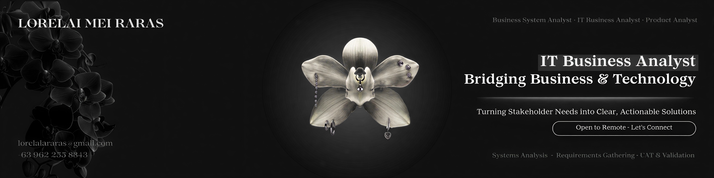

  

  
  
  
  
  

---

  <picture>
    <source media="(prefers-color-scheme: dark)" srcset="https://readme-typing-svg.demolab.com?font=Fira+Code&weight=500&size=18&pause=1200&color=FFFFFF&center=true&vCenter=true&width=680&lines=Business+Systems+Analyst;Product+%26+Project+Delivery;From+Planning+to+Production;Making+Things+Work+Better;A+Little+Bit+of+Everything;Always+Learning+Something+New" />
    <source media="(prefers-color-scheme: light)" srcset="https://readme-typing-svg.demolab.com?font=Fira+Code&weight=500&size=18&pause=1200&color=0A0A0A&center=true&vCenter=true&width=680&lines=Business+Systems+Analyst;Product+%26+Project+Delivery;From+Planning+to+Production;Making+Things+Work+Better;A+Little+Bit+of+Everything;Always+Learning+Something+New" />
    
  </picture>

<em>Business Analysis · Software Delivery · Project Management · UI/UX · Creative Development</em>

꒰ she/her ꒱ · GMT+8, Philippines · English / Filipino · Open to collaborations ♡

✦ ☾ ✦

> *I like figuring out how things work, finding ways to make them better, and making sure the people using them aren't forgotten along the way.*

---

## ✦ whoami

Hi, I'm **Lorelai**! ꒰ᐢ. .ᐢ꒱ I'm a **Business Systems Analyst at BEfied (formerly Edufied Pte Ltd)** and a **BS Information Technology graduate, Cum Laude**, from Saint Louis University (2026).

A lot of my work happens between an idea and a working product. I talk with stakeholders, turn requirements into something a team can build, help coordinate development and testing, and see things through to production and client handover. I enjoy the mix of problem-solving, organization, technical details, and working with people.

Outside work, I like making websites, trying out new layouts, and building little projects just because I find them interesting. I care about how things look, but even more about whether they make sense to the person using them.

---

## ⋆˚꩜｡ What I'm doing now

**Business Systems Analyst · BEfied (formerly Edufied Pte Ltd)**  
`Remote` `May 2026 – Present`

- **Led delivery work across three client software platforms**, from requirements and functional specifications through development coordination, QA/UAT, release, and handover.
- **Drove planning and delivery of a standalone events platform** from June through its October 2026 production launch, coordinating Jira priorities, stakeholders, testing, and release readiness.
- **Investigated an issue affecting 131 production items**, coordinated an approved correction, and helped review access controls and longer-term prevention.
- **Validated 23 completed client-requested items** against requirements and actual system behavior, including integration checks and client follow-ups.

**Business Systems Analyst Intern · Edufied Pte Ltd**  
`Remote` `January – April 2026`

- Gathered requirements, mapped workflows and user roles, and documented business rules and process gaps.
- Contributed frontend work and usability improvements to membership management, applications, approvals, payments, and authentication pages.
- Worked with product, development, and QA teams on Jira tasks, reviews, testing, and improvements.
- Helped with wireframes, digital business card features, documentation, and onboarding materials.

Some work involves private client systems, so I share the scope of my contributions rather than confidential project details.

---

## 𓆩✧𓆪 How I work

| Area | What I work on |
| :-- | :-- |
| **Business & systems analysis** | Requirements, business rules, process maps, user stories, acceptance criteria, gap analysis |
| **Product & project delivery** | Planning, Agile coordination, Jira backlogs, stakeholder communication, release readiness, handover |
| **Testing & validation** | QA/UAT, test cases, defect tracking, regression checks, checking that delivered features meet requirements |
| **Technical collaboration** | API and integration checks, data flows, frontend context, documentation |
| **Design & usability** | Figma, wireframes, responsive layouts, accessibility, clearer user journeys |

---

## ✧ Selected projects & little experiments

  
  

### ✦ [Personal Portfolio](https://lorelairaras.github.io/Portfolio/) · [Source](https://github.com/lorelairaras/Portfolio)
`React` `Vite` `Tailwind CSS` `Frontend`

My own corner of the internet. I built it to share my work and interests, with different visual moods, animated sections, and room to keep experimenting. I want it to feel like a place someone can actually explore, not just a list of links.

### ☾ [LifeOS Dashboard](https://lorelairaras.github.io/LifeOS-Dashboard/)
`Personal Project` `Frontend` `Work in Progress`

A personal dashboard I'm experimenting with for organizing tasks and everyday routines. It's also a place to practice interface design, component structure, and making information easier to follow.

### ✧ Ticket Monitoring System · Academic Project (2025)
`Project Management` `Business Analysis` `Documentation`

A ticket allocation, sales tracking, and remittance monitoring system project for Saint Louis University's Center for Culture and the Arts.

- Led project planning, team coordination, milestones, and documentation.
- Worked with stakeholders to understand existing processes and map requirements and workflows.
- Prepared specifications, diagrams, and supporting documentation for the development team.

*My role was project management, analysis, and documentation, not coding the system.*

### ✦ Frontend Mentor & web experiments

I like trying responsive layout challenges, small interactions, and new ideas for the web. I'll add more here as I finish them. (˶ᵔ ᵕ ᵔ˶)

---

## 𓆩✧𓆪 Skills & tools

**Business analysis & delivery**  
`Requirements Analysis` `SDLC` `Process Mapping` `User Stories` `Acceptance Criteria` `Agile/Scrum` `Jira` `Confluence` `QA/UAT` `Stakeholder Coordination`

**Collaboration & design**  
`Figma` `Miro` `Notion` `Git` `GitHub` `Bitbucket` `VS Code`

**Development familiarity**  
`HTML` `CSS` `JavaScript` `TypeScript` `React` `Next.js` `Tailwind CSS` `SQL` `REST APIs`

**Currently practicing**  
`Python` `Power BI` `Advanced SQL` `Three.js / WebGL` `Cloud Concepts`

---

## ☾⋆ Certifications & coursework

Google / Coursera coursework, 2026. Expand a category to see the course titles.

<b>✧ Project Management & Agile</b>

- Foundations of Project Management
- Foundations of Agile Project Management
- Implement the Scrum Framework
- Organize Projects and Measure Productivity with Scrum

<b>✧ Data & Business Intelligence</b>

- Foundations of Data Science
- Foundations of Business Intelligence
- Introducing Data Analytics and Analytical Thinking
- Make Data-Driven Decisions
- Ask Effective Questions

<b>✧ IT & Cybersecurity</b>

- Foundations of Cybersecurity
- Technical Support Fundamentals
- Network Architecture
- Network Operations
- Secure Against Network Intrusions

<b>✧ Professional & Stakeholder Skills</b>

- Working Effectively with Stakeholders
- Always Remember the Stakeholder
- Organizing Communication and Documentation
- Create a High-Performing Team
- Capture and Captivate Your Audience

<b>✧ Programming</b>

- Crash Course on Python
- Hello, Python!
- Functions and Conditional Statements
- Loops and Strings

<b>✧ UX & Digital Marketing</b>

- Foundations of User Experience (UX) Design
- Foundations of Digital Marketing and E-commerce
- Listening and Engagement on Social Media
- Transform Engagement into Customers

<b>✧ Additional completed coursework</b>

- Introduction to AI
- Discover the Art of Prompting
- Design Prompts for Everyday Work Tasks
- Maximize Productivity with AI Tools
- Use AI Responsibly

---

## ✮⋆｡°✩ Things I'm learning

- **Better ways to deliver software:** Getting stronger at technical business analysis, product decisions, and making complicated workflows easier to understand.
- **Data & reporting:** Practicing SQL, dashboards, and ways to use data when making decisions.
- **Creative frontend:** Exploring animation, responsive design, and interactive web experiences.
- **Whatever catches my curiosity:** Sometimes it's a useful tool; sometimes it's a tiny website detail that I spend way too long adjusting. (｡•̀ᴗ-)✧

---

## ☾ A few things outside work

I love music and concerts, photography, cooking, thrifting, reading, films and documentaries, traveling, hiking, nature walks, swimming, cycling, and finding new places to visit. I also really enjoy seeing how other people make their own corners of the internet.

---

## 𓆩✧𓆪 GitHub activity & little internet creatures

  <picture>
    <source media="(prefers-color-scheme: dark)" srcset="https://github-readme-stats.vercel.app/api?username=lorelairaras&show_icons=true&theme=github_dark&bg_color=0d0d0d&title_color=ffffff&text_color=888888&icon_color=ffffff&hide_border=true" />
    <source media="(prefers-color-scheme: light)" srcset="https://github-readme-stats.vercel.app/api?username=lorelairaras&show_icons=true&bg_color=ffffff&title_color=0a0a0a&text_color=555555&icon_color=0a0a0a&hide_border=true" />
    
  </picture>
  <picture>
    <source media="(prefers-color-scheme: dark)" srcset="https://streak-stats.demolab.com/?user=lorelairaras&theme=dark&background=0d0d0d&ring=ffffff&fire=aaaaaa&currStreakLabel=888888&hide_border=true" />
    <source media="(prefers-color-scheme: light)" srcset="https://streak-stats.demolab.com/?user=lorelairaras&background=ffffff&ring=0a0a0a&fire=555555&currStreakLabel=555555&hide_border=true" />
    
  </picture>

  <picture>
    <source media="(prefers-color-scheme: dark)" srcset="https://github-readme-stats.vercel.app/api/top-langs/?username=lorelairaras&layout=compact&theme=github_dark&bg_color=0d0d0d&title_color=ffffff&text_color=888888&hide_border=true&langs_count=8" />
    <source media="(prefers-color-scheme: light)" srcset="https://github-readme-stats.vercel.app/api/top-langs/?username=lorelairaras&layout=compact&bg_color=ffffff&title_color=0a0a0a&text_color=555555&hide_border=true&langs_count=8" />
    
  </picture>

### ✧ GitHub metrics

<!-- Generated by .github/workflows/metrics.yml. Requires a working workflow and output file. -->

  

### ☾ Contribution snake

<!-- Generated by .github/workflows/snake.yml on the output branch. -->

  <picture>
    <source media="(prefers-color-scheme: dark)" srcset="https://raw.githubusercontent.com/lorelairaras/lorelairaras/output/github-snake-dark.svg" />
    <source media="(prefers-color-scheme: light)" srcset="https://raw.githubusercontent.com/lorelairaras/lorelairaras/output/github-snake.svg" />
    
  </picture>

---

## ✦ Just a little more about me

`ENFP / INFP` · `Always curious` · `Probably working on another side project`

I like good conversations, creative ideas, organized notes, and making things easier for other people. I'm usually juggling a few interests at once, and I'm happiest when I get to learn something while making something useful.

  

<em>probably overthinking the spacing on this page right now (˶˃ ᵕ ˂˶)</em>

---

## ⋆˚꩜｡ Open to

`Remote` `Hybrid` `Full-Time` `Freelance` `Creative Collaborations` `Volunteer Projects`

If you'd like to talk about a project, swap ideas, or just say hello, feel free to reach out. I'd be happy to hear from you! ♡

---

♡ ☾ ♡

<em>thanks for stopping by. see you around the internet! ꒰ᐢ. .ᐢ꒱</em>

<a href="https://lorelairaras.github.io/Portfolio/">Portfolio</a> · <a href="https://github.com/lorelairaras/lorelairaras/blob/main/assets/LorelaiRaras-Resume.pdf">Resume</a> · <a href="https://linkedin.com/in/lorelai-raras">LinkedIn</a> · <a href="mailto:lorelairaras@gmail.com">Email</a>

